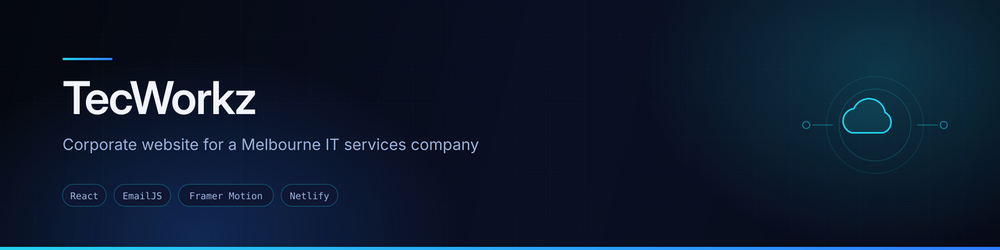
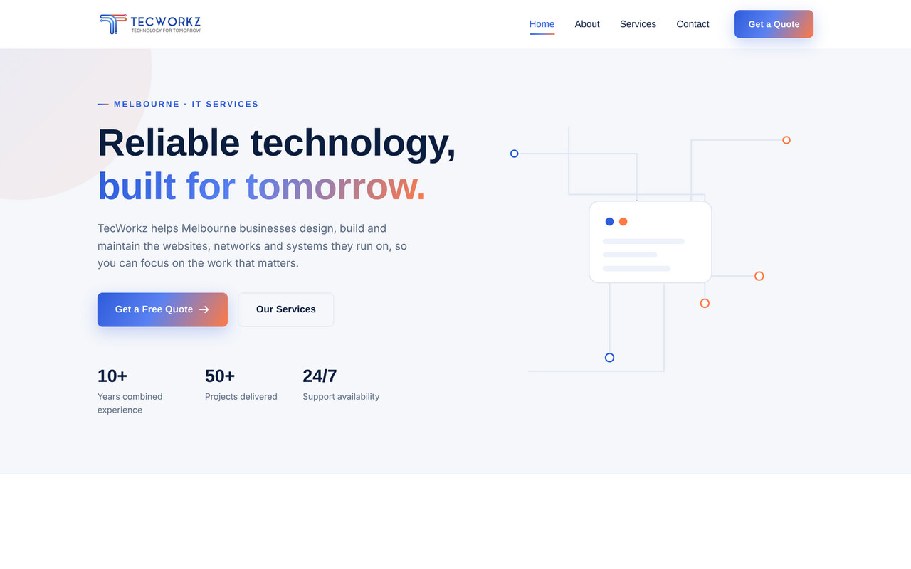

<div align="center">
  
</div>

<div align="center">


</div>

## Overview

Corporate marketing website built for **TecWorkz**, an IT services company based in Melbourne, Australia. The site presents the company's services, credibility and contact channel to prospective business clients.

This was a paid freelance engagement — my first commercial project delivered in Australia. I handled the whole pipeline: design implementation, front-end build, contact-form integration, deployment and custom domain configuration.

## Preview



<sub>Screenshot captured from a local production build of this repository.</sub>

## Features

- **Multi-page site** — Home, About, Services and Contact, routed client-side with React Router, plus a custom 404 page
- **Working contact form** — submissions delivered straight to the client's inbox via EmailJS, no backend server required
- **Scroll and entrance animations** — Framer Motion for component transitions, AOS for scroll-triggered reveals
- **Service cards** — reusable component presenting each service offering
- **Scroll restoration** — a `ScrollToTop` component resets scroll position on every route change
- **Responsive layout** — built for desktop, tablet and mobile
- **SEO and deployment basics** — `sitemap.xml`, `robots.txt`, Google site verification and a Netlify `_redirects` rule so deep links resolve correctly

## Tech stack

| Layer | Technology |
|---|---|
| Framework | React (Create React App) |
| Routing | React Router DOM |
| Animation | Framer Motion, AOS |
| Icons | Font Awesome |
| Contact delivery | EmailJS |
| Hosting | Netlify, custom domain via GoDaddy |

## Project structure

```
src/
├── components/        Navbar, Footer, ScrollToTop, Services, CTA, WhyUs
├── pages/             Home, About, Services, Contact, NotFound
├── App.js             Route definitions and AOS initialisation
└── index.js           Entry point
public/                Static assets, sitemap.xml, robots.txt, _redirects
```

## Running locally

```bash
git clone https://github.com/AJAY2043/tecworkz.git
cd tecworkz
npm install
npm start
```

The development server runs at `http://localhost:3000`.

To create a production build:

```bash
npm run build
```

## Configuration

The contact form uses EmailJS. Credentials are currently defined in `src/pages/Contact/Contact.jsx`. To run with your own EmailJS account, move them into an `.env` file at the project root:

```bash
REACT_APP_EMAILJS_SERVICE_ID=your_service_id
REACT_APP_EMAILJS_TEMPLATE_ID=your_template_id
REACT_APP_EMAILJS_PUBLIC_KEY=your_public_key
```

> EmailJS public keys are designed to be exposed client-side, but keeping them in environment variables makes the project easier to fork and reconfigure.

## Possible improvements

- Move EmailJS configuration to environment variables
- Add form validation feedback and a submission success state
- Lighthouse pass for accessibility and performance
- Migrate from Create React App to Vite for faster builds

## Author

**Ajay Krishna Reddy Bhavanam** — Melbourne, Australia
[LinkedIn](https://linkedin.com/in/ajay-krishna-reddy) · [GitHub](https://github.com/AJAY2043)
